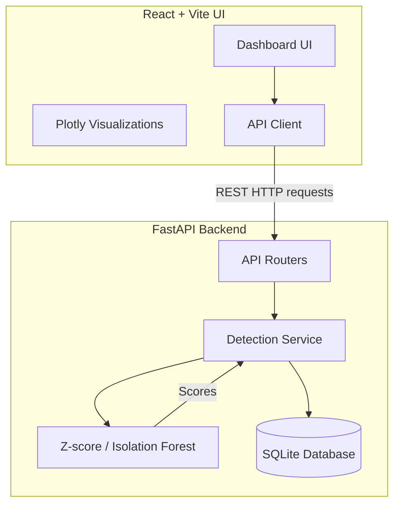

# OrbitGuard AI - SatShield

## Project Purpose and Scope
OrbitGuard AI is designed to monitor spacecraft telemetry and detect anomalies using machine learning techniques. SatShield aims to provide real-time and historical visualization of telemetry data alongside anomaly scores, alerting operators to potential issues in spacecraft subsystems before they lead to catastrophic failures.

## Features Implemented
- **Landing Page & Hero 3D Earth (`/`)**: Immersive Three.js Earth in deep space, SATSHIELD Nevera branding, scroll storytelling, skip-to-console CTA, and reduced-motion fallback.
- **Mission Control Dashboard (`/dashboard`)**: Consolidated operations overview with live indicators, interactive 3D globe, prioritized anomaly triage queue, and Plotly time-series timeline.
- **Satellite Fleet Directory (`/satellites`)**: Searchable and filterable spacecraft registry strictly disambiguating sovereign operating country from transient sub-satellite ground track coordinates.
- **Interactive 3D Spacecraft Twin (`/spacecraft`)**: CAD-grade Three.js procedural digital twin with selectable subsystems (EPS, TCS, AOCS, TT&C, OBC, SENSORS), camera re-centering, and telemetry/anomaly linkage.
- **Computer Vision Inspection (`/vision`)**: Satellite imagery defect analysis workflow with drag-drop upload, image validation, toggleable bounding boxes, defect confidence scores, and honest simulated demo disclosure.
- **Telemetry Explorer & Replay (`/telemetry`, `/replay`)**: High-density Plotly telemetry charts with decimation downsampling and historical playback scrubber.
- **Global Typography System**: Configured `Nevera` for titles/display headers and `Kineks` for all body text, tables, telemetry indicators, and Plotly charts.
- **Backend API (100% Preserved & Unmodified)**: FastAPI REST endpoints for live telemetry, channels, anomalies, and in-process detection models.
- **Honest Data Provenance**: Strict labeling distinguishing live backend telemetry streams from simulated Keplerian orbits and demo vision detections.

## Architecture and Data Flow



## Dataset Provenance
The backend ingests data based on NASA's Telemanom dataset format. Real spacecraft telemetry structures were adapted for the models. 
- Semantic labeling (subsystems/units) is constrained to explicitly prevent hallucinated physical mappings.
- **License**: The original Telemanom dataset is provided under the Apache 2.0 license by NASA.

## Installation and Setup

### Prerequisites
- Node.js (v22+)
- Python 3.12+

### Frontend Setup
```bash
# Navigate to the correct directory
cd "D:\Projects\OrbitGuard AI\ORBITGUARD-AI"

# Install dependencies
npm install

# Start the dev server
npm run dev
```

### Backend Setup
```bash
# Navigate to the backend directory
cd "D:\Projects\OrbitGuard AI\ORBITGUARD-AI\backend"

# Create a virtual environment (optional but recommended)
python -m venv venv
.\venv\Scripts\activate

# Install requirements
pip install -r requirements.txt

# Start the FastAPI server
uvicorn main:app --reload
```

## Running Tests
To run backend tests using pytest:
```bash
cd "D:\Projects\OrbitGuard AI\ORBITGUARD-AI\backend"
pytest
```

## Reproducing Evaluation Metrics
Model evaluation results (e.g., `results.csv`) are generated by running the standalone model scripts in `backend/detectors`.
- To test the Isolation Forest: `python -m backend.detectors.isolation_forest`
- Metrics such as Precision, Recall, and F1-score are calculated using a held-out test set without data leakage from the training phase.

## Model and Threshold Configuration
- **Z-Score**: Configurable threshold (e.g., 3.0 standard deviations) via the API or model parameters.
- **Isolation Forest**: Contamination parameter is tuned based on expected anomaly rates (e.g., 0.05).

## Known Limitations
- The current system maps channel names like `P-1` or `T-1` generically. Physical mappings (e.g., "Main Engine Temp") are explicitly marked as "Unknown" to avoid inaccurate assertions.
- Some data used in tests is simulated or dynamically generated for fallback scenarios and should not be treated as actual real-world anomalies without human review.

## Team Contributions
- **Person 1**: Frontend UI/UX, data visualization (Plotly), modern aesthetics, and 3D integration.
- **Person 2**: Backend API (FastAPI), machine learning integration (Z-score, Isolation Forest), database management (SQLite).
